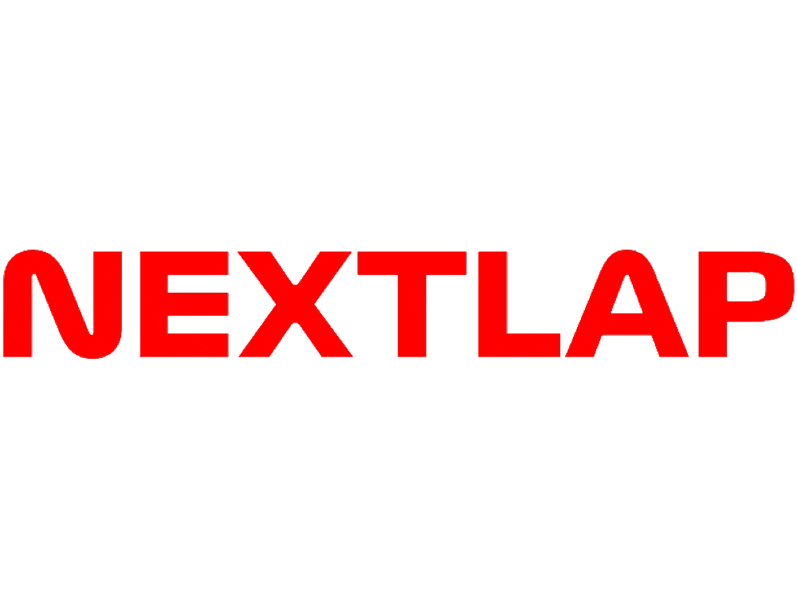
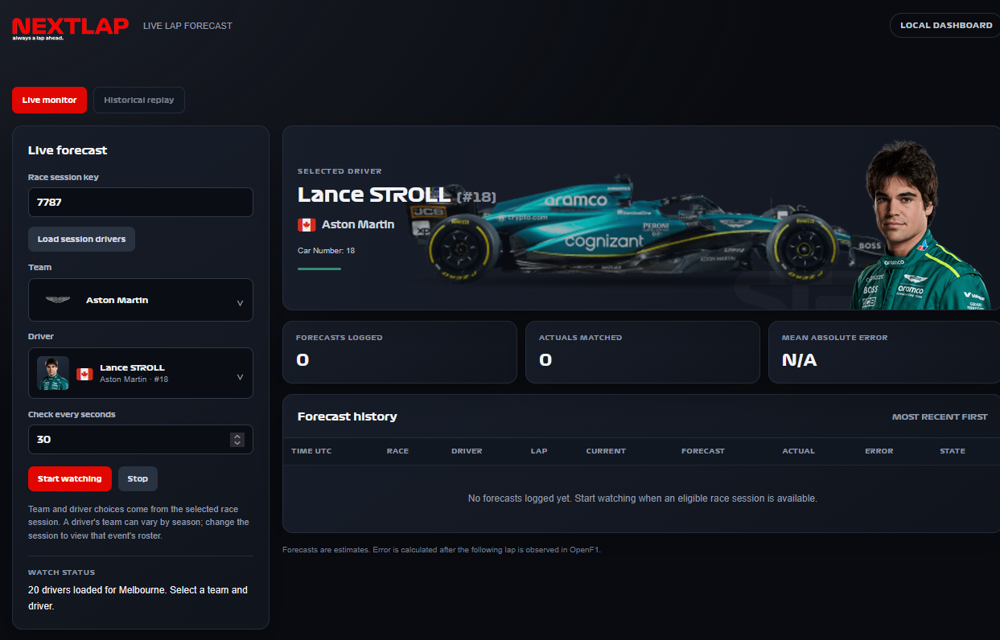
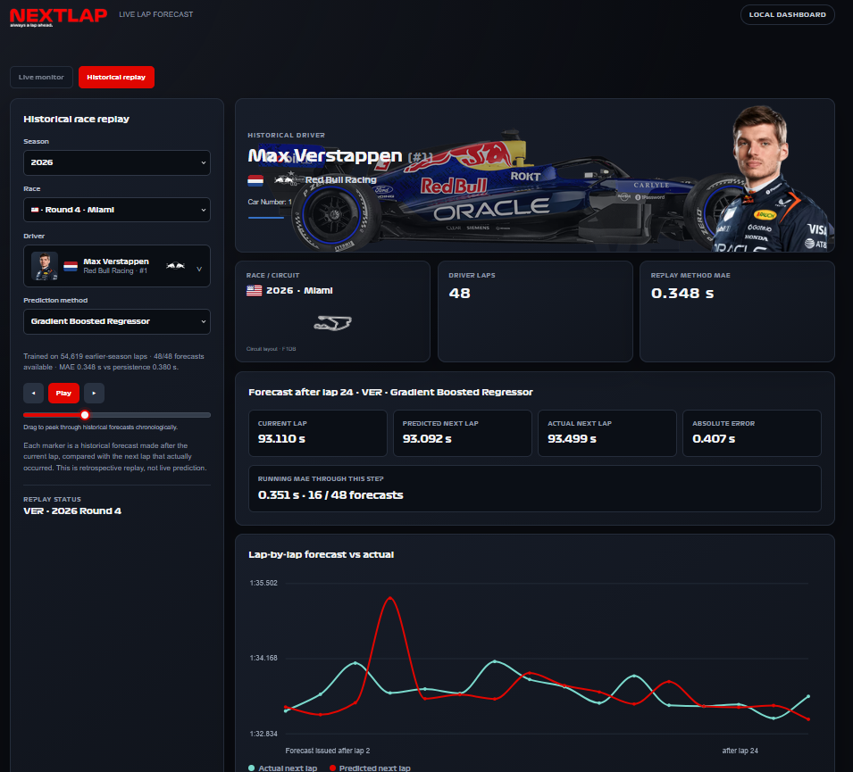

 <p align="center">
  
  <h1 align="center">NextLap</h1>
  <p align="center">
    A machine learning-powered Formula 1 lap-time prediction dashboard.
    <br />
    Monitor live sessions, replay historical races, and evaluate prediction accuracy.
    <br />
    <br />
    <a href="https://nextlap.pages.dev"><strong>Explore the Demo</strong></a>
    ·
    <a href="https://github.com/seigfriedbyfrankocean/NextLap/issues">Report a Bug</a>
    ·
    <a href="https://github.com/seigfriedbyfrankocean/NextLap/issues">Request a Feature</a>
  </p>
  <p align="center">
    
    
    <a href="LICENSE"></a>
  </p>
</p>

---

## Table of Contents

- [About The Project](#about-the-project)
  - [Built With](#built-with)
- [Features](#features)
- [Screenshots](#screenshots)
- [Getting Started](#getting-started)
  - [Prerequisites](#prerequisites)
  - [Installation](#installation)
  - [Running Locally](#running-locally)
- [Usage](#usage)
- [Model Evaluation](#model-evaluation)
- [Project Structure](#project-structure)
- [Roadmap](#roadmap)
- [Contributing](#contributing)
- [License](#license)
- [Disclaimer](#disclaimer)

---

## About The Project

Formula 1 races are shaped by constantly changing conditions. Tyre degradation, fuel load, weather, safety cars, and circuit characteristics all influence how quickly a driver completes a lap.

**NextLap is an attempt to model one small but interesting part of that complexity: predicting the next lap time.**

The project combines historical race data, machine learning, and live telemetry in an interactive dashboard. It provides two ways to explore predictions: monitoring incoming data during live sessions and replaying completed races to compare forecasts with actual lap times.

Beyond generating predictions, NextLap includes a baseline comparison to help evaluate whether its machine learning model provides a meaningful improvement over a simpler approach.

The project is built around three questions:

- How accurately can the next lap time be predicted from available race context?
- How do predictions compare with a simple circuit-median baseline?
- How does model performance hold up across different races and conditions?

### Built With

- [Python](https://www.python.org/) — application logic and data processing
- [Scikit-learn](https://scikit-learn.org/) — machine learning and model evaluation
- [OpenF1](https://openf1.org/) — live and historical Formula 1 data
- HTML, CSS, and JavaScript — interactive dashboard interface
- [Cloudflare Pages](https://pages.cloudflare.com/) — hosted static demo

---

## Features

### Live Race Monitoring

Connect to OpenF1 through the local Python application and process incoming session data as it becomes available. The dashboard brings race context and next-lap forecasts into one interface.

### Historical Race Replay

Step through completed races and examine predictions alongside actual lap times. Historical replay makes it possible to investigate model behaviour across different stages of a race.

### Machine Learning Predictions

Use a Gradient Boosting model to estimate the next lap time from available race and telemetry features.

### Baseline Benchmarking

Compare machine learning predictions against a circuit-median baseline to establish a reference point for model performance.

### Race-Specific Context

Explore relevant session information, including season, round, circuit, driver, team, and telemetry context.

---

## Screenshots

### Live Monitor

Follow a live session through the dashboard, with incoming race data used to produce next-lap forecasts.



### Historical Replay

Review completed races, step through lap predictions, and compare forecasts with observed lap times.



---

## Getting Started

The local application provides access to live monitoring and the dashboard's local functionality. The hosted demo focuses on precomputed historical replay data.

### Prerequisites

- Python 3.9 or later
- Git
- An internet connection for OpenF1 data access

### Installation

1. Clone the repository.

   ```bash
   git clone https://github.com/seigfriedbyfrankocean/NextLap.git
   ```

2. Navigate to the project directory.

   ```bash
   cd NextLap
   ```

3. Create and activate a virtual environment.

   **Windows PowerShell**

   ```powershell
   python -m venv .venv
   .\.venv\Scripts\Activate.ps1
   ```

4. Install the project dependencies using the dependency manifest provided in the repository.

   ```powershell
   pip install -r requirements.txt
   ```

### Running Locally

Start the local application from the repository root:

```powershell
python local_app.py
```

Open the dashboard at:

[http://127.0.0.1:8765](http://127.0.0.1:8765)

To stop the application, press `Ctrl + C` in the terminal.

### Hosted Demo

Explore the hosted version at [nextlap.pages.dev](https://nextlap.pages.dev).

The demo includes precomputed historical replay data covering the 2023–2026 seasons. Live session monitoring requires the local Python application and a connection to OpenF1.

---

## Usage

### 1. Explore live sessions

Run the local application and open the dashboard. During supported live sessions, NextLap processes incoming data and generates forecasts as the necessary information becomes available.

### 2. Replay completed races

Use Historical Replay to examine completed races and compare model forecasts against actual lap times.

### 3. Evaluate prediction quality

Use the benchmarking functionality to compare the Gradient Boosting model with the circuit-median baseline. This provides a reference for understanding whether the model adds predictive value.

### 4. Rebuild the hosted replay dataset

After changing the underlying data or model configuration, regenerate the static demo data using:

```powershell
python build_static_demo.py
```

The resulting dataset can be used to refresh the historical replay experience on the hosted demo.

---

## Model Evaluation

A prediction model is only useful if its performance can be measured against a meaningful reference.

NextLap compares its Gradient Boosting model with a circuit-median baseline. This helps distinguish improvements attributable to the model from performance that can be achieved using a simpler statistical estimate.

The project also uses a holdout dataset for additional evaluation.

### Recorded Results (Earlier Dataset)

The following MAEs are recorded results from earlier evaluation runs. They have **not yet been verified on the rebuilt v3 dataset** and are not a fresh evaluation of the current dataset or model artifacts.

Mean absolute error (MAE) is reported in seconds; **lower is better**.

| Approach | Held-out races MAE (s) | 2026 held-out season MAE (s) |
|---|---|---|
| Persistence baseline | 0.409 | 0.486 |
| Circuit baseline | **0.408** | **0.485** |
| Recent-pace baseline | 0.425 | 0.500 |
| Ridge regression | 0.441 | 0.554 |
| HistGradientBoosting | 0.541 | 0.793 |

**The trained models do not outperform the circuit baseline in either evaluation.** On held-out races, Ridge has approximately **8.1% higher MAE** and HistGradientBoosting approximately **32.6% higher MAE** than the circuit baseline. These percentages use `(model MAE / circuit baseline MAE - 1) * 100` and the rounded values above; they represent worse performance, not an improvement.

### Data Quality Caveat

A data-filtering/race-control bug in the v3 dataset builder is currently being investigated: an invalid red-flag window for the 2023 Australian Grand Prix ended before it started. Invalid windows could incorrectly include or exclude laps affected by race-control events. The effect on dataset filtering and evaluation results has not yet been established.

These figures describe performance on the earlier dataset only. The race-control issue needs to be resolved, the rebuilt dataset validated, and the evaluations rerun before reporting verified v3 results.

Areas of interest include:

- Prediction error across different races and circuits
- Differences between model predictions and actual lap times
- Generalization to data held out from model development
- The influence of changing race conditions on prediction accuracy

Model performance depends on data quality, feature availability, and the conditions represented in the evaluation dataset. Results should therefore be interpreted alongside the limitations of the underlying data.

---

## Project Structure

| File or Directory | Purpose |
|---|---|
| `local_app.py` | Local server and dashboard entry point |
| `web/` | Frontend, static assets, fonts, and circuit layouts |
| `predict_live.py` | Live telemetry processing and forecast generation |
| `model_fit.py` | Gradient Boosting model training |
| `build_static_demo.py` | Generates precomputed data for the hosted demo |
| `laps_sample_v3.csv` | Historical lap dataset used for training and evaluation |
| `replay_2026_holdout.csv` | Holdout dataset for model evaluation |
| `docs/screenshots/` | Dashboard screenshots used in this README |

---

## Contributing

Contributions, suggestions, ,constructive feedback and bug reports are welcome through the [GitHub Issues](https://github.com/seigfriedbyfrankocean/NextLap/issues) page.

1. Fork the repository.
2. Create a feature branch.

   ```bash
   git checkout -b feature/your-feature
   ```

3. Commit your changes.

   ```bash
   git commit -m "Add your feature"
   ```

4. Push the branch.

   ```bash
   git push origin feature/your-feature
   ```

5. Open a pull request describing the changes.

For larger changes, consider opening an issue first to discuss the proposed approach.

---

## License

Distributed under the MIT License. See [LICENSE](LICENSE) for details.

---

## Disclaimer

NextLap is an independent, non-commercial fan project. It is not affiliated with, associated with, or endorsed by Formula 1, Formula One Management (FOM), the FIA, or any Formula 1 team.

All Formula 1 trademarks, team names, driver names, and related marks belong to their respective owners.

<p align="center">
  <a href="#nextlap">Back to top</a>
</p>
