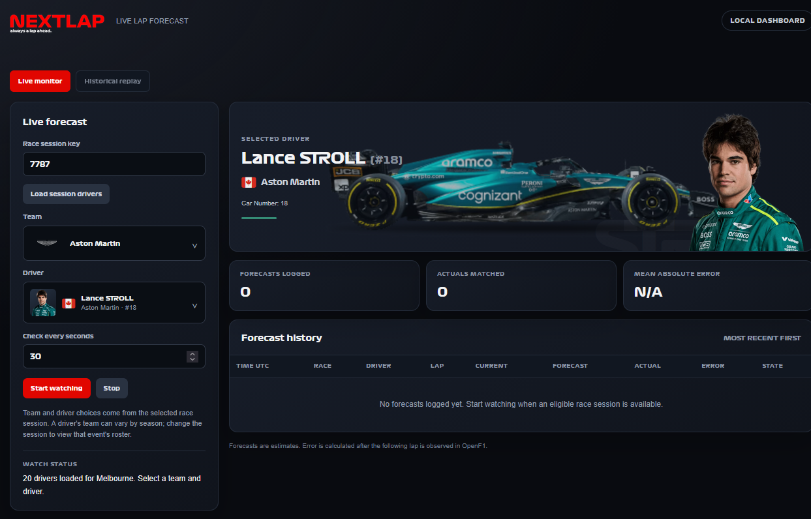
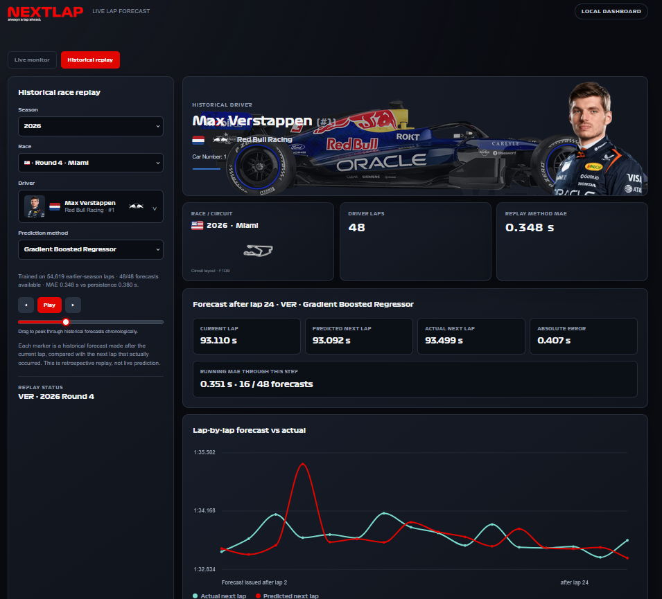

# NextLap

NextLap is a Formula 1 lap-time forecasting project. The local dashboard reads OpenF1 race data and makes a simple next-lap forecast. The hosted demo replays completed races and compares that forecast with circuit-median and machine-learning estimates.

Try the hosted replay at [nextlap.pages.dev](https://nextlap.pages.dev).

## What it does

- Watches a live race from the local app and logs next-lap forecasts.
- Replays completed races in the hosted demo.
- Compares persistence, circuit-median, Ridge, and HistGradientBoosting predictions.

## Screenshots

### Live monitor



### Historical replay



## How it works

The target is the change from the current lap to the next one: `NextLapSeconds - LapSeconds`. A prediction estimates that change, then adds it to the current lap time. The historical models use driver, team and season, circuit, tyre compound and age, fresh-tyre status, track and air temperature, and current-lap time.

The live monitor currently uses a persistence forecast: it predicts that the next lap will match the latest completed lap. The fitted models are used in historical replay and evaluation.

Evaluation uses two splits:

- Five-fold `GroupKFold` cross-validation holds out whole races, so laps from a test race do not appear in its training fold. The current dataset contains 67,707 rows across 75 races.
- The separate 2026 holdout is chronological: models train on 54,619 rows from 2023 through 2025, then score 12,131 rows from 2026. The 2026 holdout is kept out of model fitting.

Lower MAE is better. These results show the fitted models behind the simple baselines:

| Predictor | Race-held-out CV MAE (s) | 2026 holdout MAE (s) |
|---|---:|---:|
| Persistence | 0.408 | 0.486 |
| Circuit median | **0.407** | **0.485** |
| Ridge regression | 0.437 | 0.556 |
| HistGradientBoosting | 0.524 | 0.778 |

Neither fitted model beat the circuit-median baseline. On the 2026 holdout, HistGradientBoosting had 0.778 s MAE versus 0.485 s for the circuit median.

## Stack

- Python, NumPy, pandas, and scikit-learn for data processing and model evaluation
- OpenF1 for live and historical race data
- Vanilla JavaScript, HTML, and CSS for the dashboard; no frontend framework
- Cloudflare Pages for the hosted replay demo

## Run locally

From the repository root, create and activate a virtual environment and install the dependencies:

```powershell
python -m venv .venv
.\.venv\Scripts\Activate.ps1
python -m pip install -r requirements.txt
```

Start the dashboard:

```powershell
python local_app.py
```

Open [http://127.0.0.1:8765](http://127.0.0.1:8765). Press `Ctrl+C` in the terminal to stop it. Live monitoring requires OpenF1 live-data access; historical replay uses the included data.

## Refresh race replay data

To rebuild the historical dataset and replay files manually:

```powershell
python build_dataset_openf1_v3.py
python build_static_demo.py
```

GitHub Actions also runs the refresh on Monday evenings and can be started manually from the Actions tab. A successful run commits the new data and replay files; the hosted site then redeploys through its Git connection.

## Limitations and next steps

- The live monitor uses the current lap as its forecast and does not predict pit strategy.
- The live forecast skips wet, pit-out, pit-in, and neutralised laps.
- The historical dataset excludes wet races and races with incomplete lap data.
- The fitted models currently trail the circuit-median baseline. Improving the features and validating future seasons remain open work.

## Project layout

| Path | Purpose |
|---|---|
| `src/local_app.py` | Local dashboard server |
| `src/predict_live.py` | Live-session data handling and forecast logging |
| `src/predict_next_lap.py` | Persistence and circuit-median forecast helpers |
| `src/build_dataset_openf1_v3.py` | OpenF1 dataset builder |
| `src/build_static_demo.py` | Generates replay files for the hosted site |
| `src/analysis/` | Offline model fitting, backtesting, and tyre analysis |
| `data/laps_sample_v3.csv` | Historical training dataset |
| `data/replay_2026_holdout.csv` | 2026 holdout predictions and errors |
| `data/reports/` | Dataset audit outputs |
| `data/archive/` | Earlier dataset and analysis artifacts |
| `web/` | Dashboard frontend, assets, and generated replay data |

## Contributing

Bug reports, suggestions, and constructive feedback are welcome through [GitHub Issues](https://github.com/seigfriedbyfrankocean/NextLap/issues).

## License

Distributed under the MIT License. See [LICENSE](LICENSE).

## Disclaimer

NextLap is an independent, non-commercial fan project. It is not affiliated with Formula 1, Formula One Management, the FIA, or any Formula 1 team. All related trademarks belong to their respective owners.
